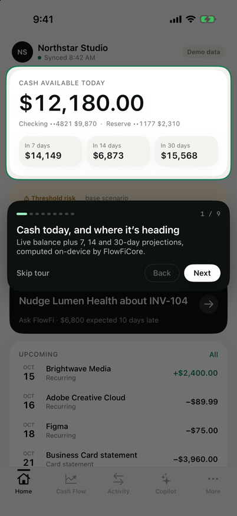
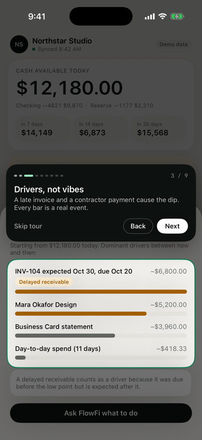
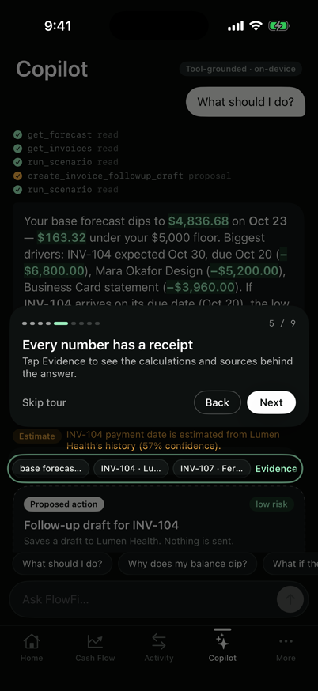
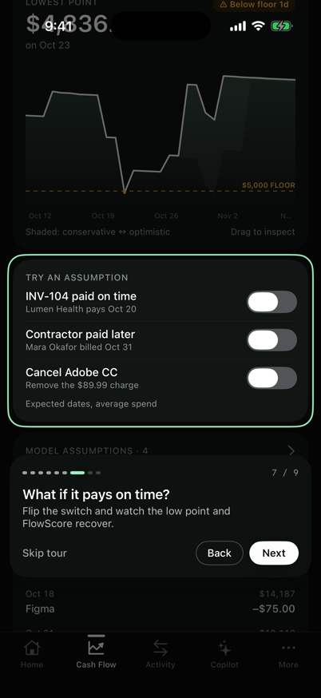

# FlowFi for iOS (SwiftUI)

Native iOS app (iOS 17+) built on **FlowFiCore**, a Swift package that ports the web demo's deterministic engine. It's covered by parity tests, so the phone and the website show identical numbers for the fictional Northstar Studio workspace.

<p>
  
  
  
  
</p>

## What's inside

| Area | Implementation |
|---|---|
| Engine | `Packages/FlowFiCore`: recurring detection, invoice late-risk, 3-scenario forecast, FlowScore, alerts. Integer cents, pure civil-date math, no Foundation calendars |
| Copilot | 11 typed tools, deterministic intent router, grounded response contract, approval boundary (`Approvals.execute`) |
| Sync reliability | `Ledger` **actor**: idempotent webhooks, coalescing, full-jitter backoff, atomic pages, cursor-after-commit, quarantine. Fault lab runs 8 drills on-device |
| UI | SwiftUI + Swift Charts, custom tab bar and sheets, numeric-text transitions, hold-to-approve ring with haptics, light / dark / system appearance |
| Guided tour | Coach marks via anchor preferences: spotlight cutout over the real element, Back / Next / Skip, works inside sheets |
| Native security | `FlowFiSecureVault`: Keychain set/get/delete (`WhenUnlockedThisDeviceOnly`), LocalAuthentication, biometric availability, app lock that fails closed, device auth for medium-risk approvals |

Security boundary: no provider tokens on device, no Secure Enclave keys (not claimed), nothing leaves the device.

## Run

```bash
cd ios
xcodegen generate            # project.yml → FlowFi.xcodeproj (already committed)
open FlowFi.xcodeproj        # run on an iPhone simulator
```

Launch arguments for demos: `-tourStep N` (jump to a tour step), `-appearance dark|light`, `-resetDemo`.

## Test

```bash
cd ios/Packages/FlowFiCore && swift test     # 19 tests: parity, copilot guardrails, fault lab
```
